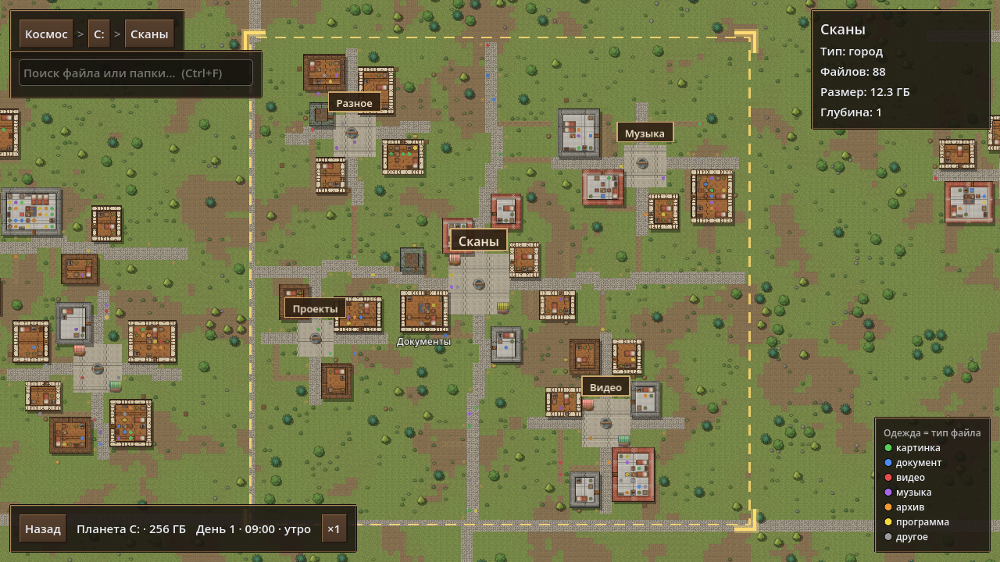
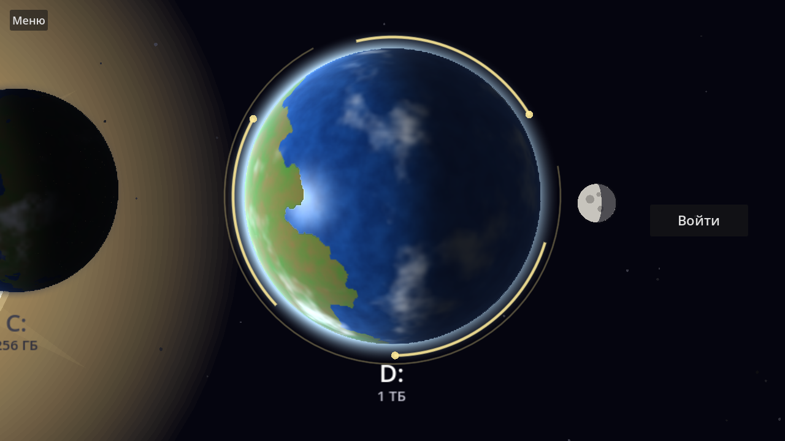
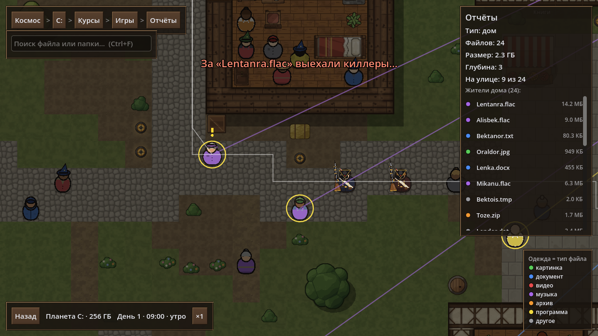
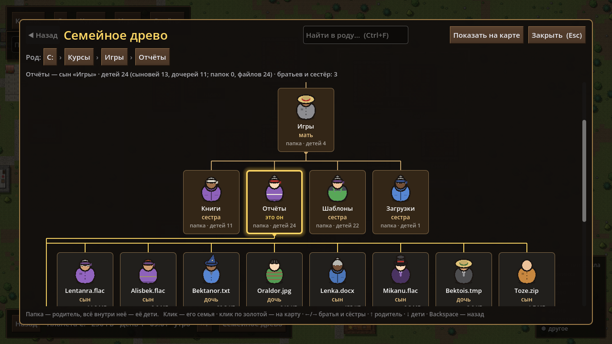

# Файловая колония

**Твои папки — города, файлы — жители.** Симулятор проводника: маленькая 2D-игра на Godot 4,
где файловая система показана как живой мир в духе колонии вид сверху. Диски — планеты
в космосе, папки — деревни и районы, файлы — человечки, которые живут в своих домах, ходят
к колодцу, болтают на площади и спят по ночам.

> 🧪 **Это тестовая версия.** Игра в разработке: что-то может работать не так, многое ещё поменяется.
>
> 🇷🇺 🇬🇧 **Русский и английский** — язык меняется в настройках (Settings → Язык / Language).
>
> 🎨 **Вдохновлено [RimWorld](https://rimworldgame.com/)** — видом сверху, человечками и живой колонией.
> Проект самостоятельный и с RimWorld не связан; вся графика своя.
>
> 📖 **Открытый исходный код** — под лицензией [MIT](LICENSE): смотри, меняй, пользуйся.

> Все диски, папки и файлы в игре **выдуманные**: игра не читает и не меняет настоящие файлы.
> «Удаление» и «копирование» происходят только внутри выдуманного мира.



## Что есть в игре

- **Космос.** Диски — планеты с облаками, огнями городов на ночной стороне и лунами.
  Солнце далеко: при движении камеры оно смещается медленнее планет. Клик по планете —
  приближение, «Войти» — нырок на поверхность.
- **Материк.** Каждая папка верхнего уровня — свой город. Подпапки с подпапками — районы,
  папки с файлами — дома, пустые папки — заброшенные хижины. Между городами мощёные дороги.
- **Жители.** Каждый файл — человечек. Цвет одежды — тип файла, внешность и головной убор
  у каждого свои. Дома сидят за столом, греются у очага, читают у полки; днём ходят по делам
  к колодцу, на рынок, в гости к соседям, болтают друг с другом; ночью спят.
- **Дома с мебелью**: кровати, столы, стулья, очаг, сундуки, шкафы, коврики.
- **Выбор дома** показывает всех его жителей: где каждый сейчас и куда идёт.
- **Правая кнопка мыши по жителю:** копировать (модель жителя видна в «буфере»), вставить
  в другой дом, удалить. За удаляемым приходят двое киллеров с мушкетами — жертва убегает
  или прячется, но её догоняют.
- **Семейное древо:** папка — родитель, всё внутри неё — её дети.
- **Поиск** файлов и папок, смена дня и ночи, ускорение времени.
- **Песочница:** любой выдуманный мир по зерну (число или слово).

| Космос | Погоня | Семейное древо |
|---|---|---|
|  |  |  |

## Как запустить

**Готовая игра (Windows):** скачай `FileColony.exe` со страницы
[Releases](../../releases) и запусти — Godot ставить не нужно. Windows может предупредить
о неизвестном издателе: «Подробнее → Выполнить в любом случае».

**Из исходников:** нужен [Godot 4.7](https://godotengine.org/download).

```bash
godot --path .
```

Или открой папку проекта в редакторе Godot и нажми F5.

## Управление

| Где | Что |
|---|---|
| Везде | WASD — камера, колёсико — приближение, Esc — назад |
| Карта | ЛКМ — выбрать / открыть, ПКМ — меню (копировать, вставить, удалить, древо) |
| Карта | Ctrl+F — поиск, Ctrl+C / Ctrl+V / Delete — для выбранного, T — семейное древо |
| Древо | ←/→ — братья и сёстры, ↑ — родитель, ↓ — дети, Backspace — назад, Enter — на карту |

## Для разработчиков

- `scripts/` — весь код (GDScript), `scenes/` — сцены, `shaders/` — шейдер планеты.
- `assets/textures/` — текстуры; их генерирует `tools/make_textures.py` (Python + Pillow).
- `tests/` — тесты на [GUT](https://github.com/bitwes/Gut) (лежит в `addons/gut`, лицензия MIT).
  Запуск без окна: `run_tests.bat`.
- `screenshot.bat --view=city --out=city.png` — скриншот нужного вида в `screenshots/`.
- Сборка `.exe`: «Проект → Экспорт → Windows Desktop» (настройки в `export_presets.cfg`).

## Лицензия

[MIT](LICENSE)
