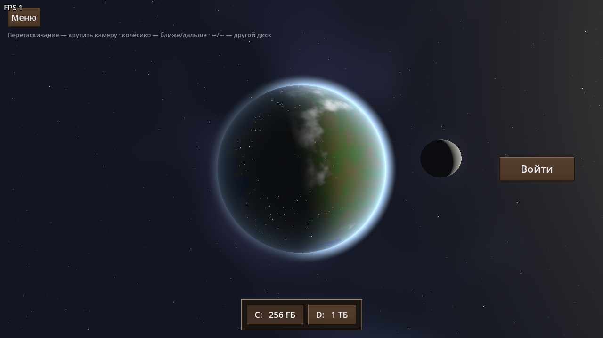
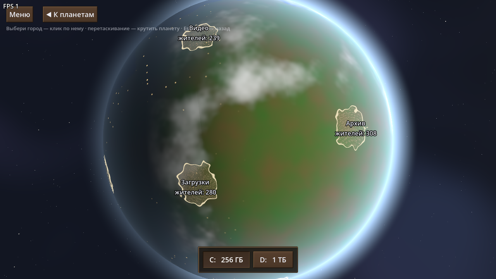
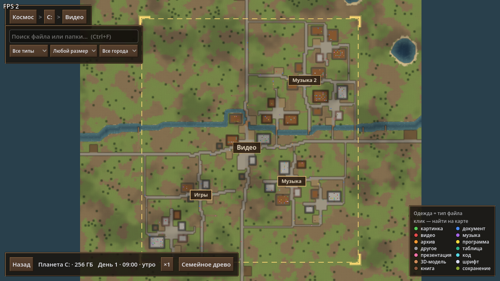
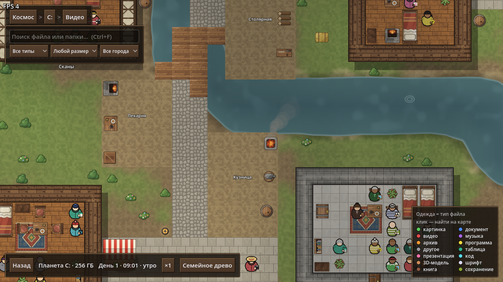
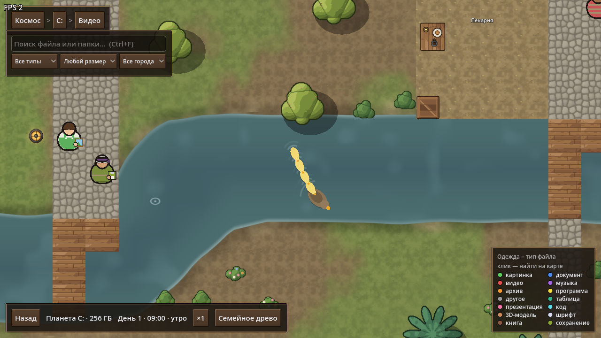
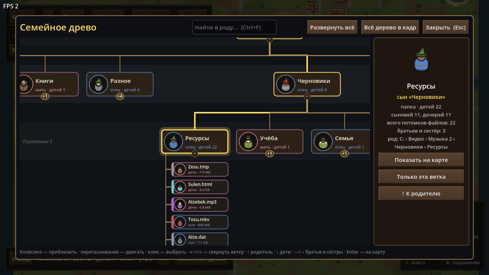

# File Colony / Файловая колония

**English** · [Русский](#русский)



---

## English

File Colony is a top-down simulation game built with Godot 4 that presents a file system as a world. Drives are planets, top-level folders are cities, subfolders are districts and houses, and files are residents with their own daily routines.

- **Status:** test release (0.2). Features and data formats may change.
- **Languages:** English and Russian. The language can be changed in Settings.
- **Platform:** Windows, 64-bit.
- **License:** [MIT](LICENSE).

> The game uses a generated file system only. It does not read, modify or delete files on your computer. Copying and deleting take place inside the game world.

### Features

- **Space.** Each drive is a 3D planet with an atmosphere, clouds and a moon. The camera orbits freely, and switching drives moves the camera from one planet to another.
- **City selection.** City boundaries, names and populations are shown on the globe. Selecting a city moves the camera down to it.
- **Cities.** Large procedurally generated maps with districts, streets and furnished houses. Once generated, a city stays the same for the rest of the session.
- **Terrain.** The terrain depends on the city's location on the planet. Coastal cities border an ocean, and inland cities have lakes and rivers. Ground textures and shorelines blend smoothly into each other.
- **Residents.** Every file is a resident whose clothing colour shows its file type. Residents work at the market, shop, bakery, smithy, carpentry workshop, fields and fishing piers, visit each other, and sleep at night.
- **File operations.** Residents can be copied, pasted into another house or deleted. Deleting a resident starts a short chase scene.
- **Family tree.** The folder hierarchy is shown as a top-down pedigree, with collapsible branches, search and a details panel.
- **Tools.** Search by name, type, size and city; a day–night cycle; time acceleration.
- **Sandbox.** Generates a random world from a seed, which can be a number or a word.

| Space | City selection | City map |
|---|---|---|
|  |  |  |

| Workplaces | Wildlife | Family tree |
|---|---|---|
|  |  |  |

### Installation

**Windows build:** download `FileColony.exe` from [Releases](../../releases) and run it. No installation is required. If Windows SmartScreen blocks the file, select **More info → Run anyway**. The executable is not code-signed.

**From source:** install [Godot 4.7](https://godotengine.org/download), then run:

```bash
godot --path .
```

Alternatively, open the project folder in the Godot editor and press F5.

### Controls

| Context | Action |
|---|---|
| Space | Drag to rotate the camera, mouse wheel to zoom, ←/→ to switch drives |
| General | WASD to move the camera, mouse wheel to zoom, Esc to go back |
| Map | Left click to select or open, right click for the context menu (copy, paste, delete, family tree) |
| Map | Ctrl+F to search, Ctrl+C / Ctrl+V / Delete for the selected item, T to open the family tree |
| Family tree | ←/→ for siblings, ↑ for the parent, ↓ for children, Backspace to go back, Enter to show on the map |

### Development

- `scripts/` contains the GDScript code, `scenes/` the scenes, and `shaders/` the planet, terrain and sky shaders.
- `assets/textures/` contains textures generated by `tools/make_textures.py` (Python + Pillow).
- `tests/` contains [GUT](https://github.com/bitwes/Gut) tests; GUT is in `addons/gut` under the MIT license. Run the tests headless with `run_tests.bat`.
- `screenshot.bat --view=city --out=city.png` saves a screenshot of a given view to `screenshots/`.
- To build the `.exe`, use **Project → Export → Windows Desktop**. The settings are in `export_presets.cfg`.

### Acknowledgements

The visual style was inspired by [RimWorld](https://rimworldgame.com/). This is an independent project and is not affiliated with RimWorld or its developers. All graphics are original.

---

## Русский

«Файловая колония» — симуляция с видом сверху на Godot 4, в которой файловая система показана как мир. Диски — планеты, папки верхнего уровня — города, вложенные папки — районы и дома, файлы — жители со своим распорядком дня.

- **Статус:** тестовая версия (0.2). Возможности и форматы данных могут меняться.
- **Языки:** русский и английский. Язык меняется в настройках.
- **Платформа:** Windows, 64 бита.
- **Лицензия:** [MIT](LICENSE).

> В игре используется только сгенерированная файловая система. Игра не читает, не изменяет и не удаляет файлы на компьютере. Копирование и удаление происходят только внутри игрового мира.

### Возможности

- **Космос.** Каждый диск — 3D-планета с атмосферой, облаками и луной. Камера свободно вращается вокруг планеты, при смене диска она перелетает от одной планеты к другой.
- **Выбор города.** На глобусе видны границы городов, их названия и число жителей. При выборе города камера спускается к нему.
- **Города.** Большие процедурно генерируемые карты с районами, улицами и обставленными домами. После генерации город не меняется до конца сессии.
- **Местность.** Местность зависит от расположения города на планете. Прибрежные города стоят у океана, во внутренних есть озёра и реки. Текстуры земли и береговые линии плавно переходят друг в друга.
- **Жители.** Каждый файл — житель, цвет одежды показывает тип файла. Жители работают на рынке, в магазине, пекарне, кузнице, столярной мастерской, на полях и мостках для рыбалки, ходят в гости и ночью спят.
- **Операции с файлами.** Жителя можно скопировать, вставить в другой дом или удалить. Удаление жителя запускает короткую сцену погони.
- **Семейное древо.** Иерархия папок показана как родословная сверху вниз: ветки сворачиваются, есть поиск и панель с подробностями.
- **Инструменты.** Поиск по имени, типу, размеру и городу; смена дня и ночи; ускорение времени.
- **Песочница.** Генерирует случайный мир по зерну — числу или слову.

### Установка

**Сборка для Windows:** скачайте `FileColony.exe` на странице [Releases](../../releases) и запустите его, установка не требуется. Если Windows SmartScreen заблокирует запуск, выберите **Подробнее → Выполнить в любом случае**. Исполняемый файл не подписан.

**Из исходников:** установите [Godot 4.7](https://godotengine.org/download) и выполните:

```bash
godot --path .
```

Также можно открыть папку проекта в редакторе Godot и нажать F5.

### Управление

| Где | Действие |
|---|---|
| Космос | Перетаскивание — вращение камеры, колесо мыши — приближение, ←/→ — другой диск |
| Везде | WASD — движение камеры, колесо мыши — приближение, Esc — назад |
| Карта | ЛКМ — выбрать или открыть, ПКМ — контекстное меню (копировать, вставить, удалить, древо) |
| Карта | Ctrl+F — поиск, Ctrl+C / Ctrl+V / Delete — для выбранного, T — семейное древо |
| Древо | ←/→ — братья и сёстры, ↑ — родитель, ↓ — дети, Backspace — назад, Enter — показать на карте |

### Разработка

- `scripts/` — код на GDScript, `scenes/` — сцены, `shaders/` — шейдеры планеты, местности и неба.
- `assets/textures/` — текстуры, их генерирует `tools/make_textures.py` (Python + Pillow).
- `tests/` — тесты на [GUT](https://github.com/bitwes/Gut); GUT лежит в `addons/gut` под лицензией MIT. Запуск без окна: `run_tests.bat`.
- `screenshot.bat --view=city --out=city.png` сохраняет скриншот нужного вида в `screenshots/`.
- Сборка `.exe`: **Проект → Экспорт → Windows Desktop**, настройки лежат в `export_presets.cfg`.

### Благодарности

Визуальный стиль вдохновлён [RimWorld](https://rimworldgame.com/). Проект независимый и не связан с RimWorld и её разработчиками. Вся графика оригинальная.
